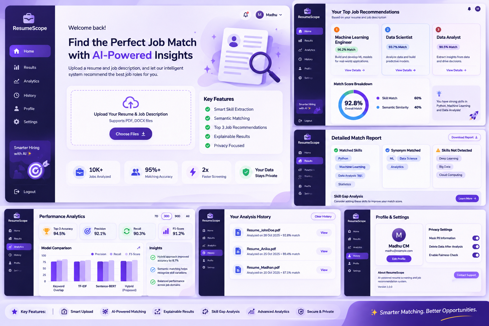
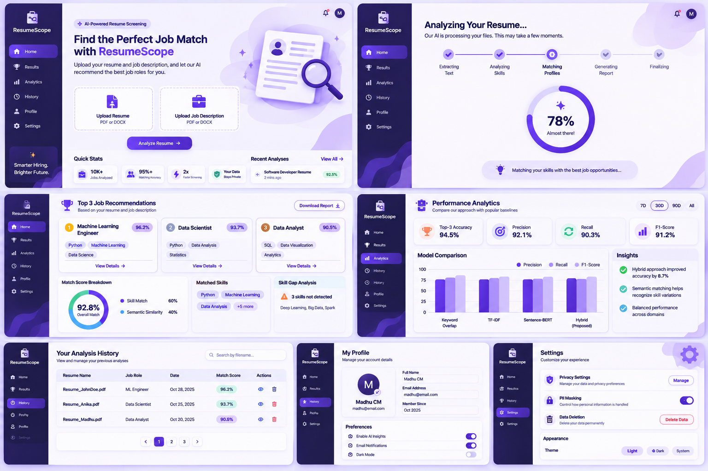

# ResumeScope

ResumeScope is an AI-assisted resume screening and job role recommendation system built with Flask and Sentence-BERT. It extracts text from PDF and DOCX resumes, identifies relevant skills, compares resumes with available job descriptions, and ranks the top job recommendations with explainable match details.

> ResumeScope provides decision-support information only. Match scores are not guarantees of employment or candidate suitability.

## Screenshots





## Features

- **Resume analysis:** Upload PDF or DOCX resumes, or paste resume text.
- **Top-3 recommendations:** Rank job roles against the project job catalog.
- **Custom job descriptions:** Analyze a resume against a pasted or uploaded target job description.
- **Hybrid matching:** Combine normalized skill matching with semantic similarity.
- **Explainable results:** View matched skills, missing skills, skill and semantic scores, and score calculations.
- **Learning resources:** Receive resource suggestions for missing or underrepresented skills.
- **Job catalog management:** Search and add job descriptions through the API.
- **Analysis history:** Save, view, delete, or clear analysis records in SQLite.
- **Account authentication:** Sign up, log in, and log out.
- **Privacy safeguards:** Mask PII before ranking and storage.
- **Fairness sensitivity check:** Test score stability after irrelevant contact details are added.
- **Benchmark comparison:** Compare keyword overlap, TF-IDF, Sentence-BERT, and the hybrid model.

## Matching Method

ResumeScope uses the following hybrid formula:

```text
Hybrid Score = (0.60 x Skill Match Score) + (0.40 x Semantic Similarity Score)
```

- **Skill Match Score:** The proportion of recognized required skills found in the resume, including curated synonym matches.
- **Semantic Similarity Score:** Cosine similarity between Sentence-BERT embeddings generated with `all-MiniLM-L6-v2`.
- **Fallback:** If a job description contains no recognized skills, the semantic similarity score is used as the complete score.

The project also includes baseline implementations for keyword overlap and TF-IDF matching.

## Technology Stack

- **Backend:** Python, Flask
- **Machine learning:** Sentence-Transformers, PyTorch, scikit-learn
- **Document parsing:** PyMuPDF, python-docx
- **Database:** SQLite
- **Frontend:** HTML, CSS, JavaScript
- **Security:** Argon2 password hashing, cryptography, HMAC email lookup protection
- **Testing:** pytest

## Project Structure

```text
AI-ResumeScreening/
|-- app.py                  # Flask application and API routes
|-- backend/
|   |-- baselines.py        # Keyword, TF-IDF, and Sentence-BERT baselines
|   |-- database.py         # SQLite initialization and data operations
|   |-- fairness.py         # Fairness sensitivity check
|   |-- hybrid_matcher.py   # Hybrid score and ranking engine
|   |-- learning_resources.py
|   |-- pii_masker.py       # PII masking
|   |-- semantic_matcher.py # Sentence-BERT model integration
|   |-- skill_extractor.py  # Skill extraction and synonym matching
|   `-- text_extractor.py   # PDF and DOCX text extraction
|-- static/                 # CSS and JavaScript
|-- templates/              # Flask HTML templates
|-- tests/                  # Unit and integration tests
|-- ui_image/               # README screenshots
|-- backend/data/           # Job and skill data
|-- requirements.txt
`-- README.md
```

## Installation

### Prerequisites

- Python 3.10 or newer
- pip
- Internet access on the first run if the Sentence-BERT model is not already cached

### Windows setup

```powershell
git clone https://github.com/16madhu/AI-ResumeScreening.git
cd AI-ResumeScreening

python -m venv .venv
.\.venv\Scripts\Activate.ps1

python -m pip install --upgrade pip
pip install -r requirements.txt
```

If PowerShell blocks script execution, activate the environment with Command Prompt instead:

```bat
.venv\Scripts\activate.bat
```

On macOS or Linux:

```bash
git clone https://github.com/16madhu/AI-ResumeScreening.git
cd AI-ResumeScreening

python3 -m venv .venv
source .venv/bin/activate

python -m pip install --upgrade pip
pip install -r requirements.txt
```

## Running the Application

```bash
python app.py
```

Open [http://127.0.0.1:5000](http://127.0.0.1:5000).

The application initializes `backend/resumescope.db` automatically and seeds it with the built-in job catalog when the database is first created. Create an account through the signup page before using the dashboard.

## API Overview

| Method | Endpoint | Description |
|---|---|---|
| `POST` | `/api/signup` | Create an account |
| `POST` | `/api/login` | Log in |
| `POST` | `/api/logout` | Log out |
| `GET` | `/api/profile` | Get the current user's profile |
| `PUT` | `/api/profile` | Update the current user's profile |
| `GET` | `/api/jobs` | List job descriptions |
| `POST` | `/api/jobs` | Add a job description |
| `GET` | `/api/jobs/search?query=...` | Search the job catalog |
| `POST` | `/api/analyze` | Analyze a resume |
| `GET` | `/api/history` | List analysis history |
| `GET` | `/api/history/<record_id>` | Get one analysis record |
| `DELETE` | `/api/history/<record_id>` | Delete one analysis record |
| `POST` | `/api/history/clear` | Clear analysis history |
| `GET` | `/api/benchmark` | Run benchmark comparisons |
| `POST` | `/api/fairness` | Run a fairness sensitivity check |

### Example: Analyze resume text

```bash
curl -X POST http://127.0.0.1:5000/api/analyze ^
  -H "Content-Type: application/json" ^
  -d "{\"resume_text\":\"Python developer experienced in Flask, SQL, machine learning, and scikit-learn.\",\"resume_name\":\"candidate.txt\"}"
```

To analyze a PDF or DOCX file:

```bash
curl -X POST http://127.0.0.1:5000/api/analyze ^
  -F "resume_file=@path/to/resume.pdf"
```

## Testing

Run the test suite from the project root:

```bash
pytest
```

To run a focused test file:

```bash
pytest tests/test_matching.py
```

The tests cover authentication, PII masking and HMAC behavior, extraction, skill matching, fairness checks, learning resources, and hybrid matching.

## Privacy and Fairness

- Resume text is masked for PII before matching and storage.
- Email addresses are stored encrypted and queried through a deterministic HMAC.
- Passwords are hashed with Argon2.
- Sensitive attributes are not used as ranking inputs.
- The fairness feature is a limited contact-detail sensitivity test, not proof of complete algorithmic fairness.

Do not commit real resumes, secrets, API keys, or personal data. The repository ignores SQLite databases, virtual environments, uploads, environment files, and secure-upload directories.

## Limitations

- Extraction quality depends on the structure of the source PDF or DOCX file.
- Skill recognition depends on the curated skill dictionary and synonym coverage.
- Sentence-BERT similarity can capture contextual relevance, but it may not represent real-world hiring suitability.
- The built-in benchmark and job catalog are project-specific and should not be interpreted as production hiring validation.

## License

No license has been selected for this repository yet. A license must be added before reuse by others can be explicitly permitted.
